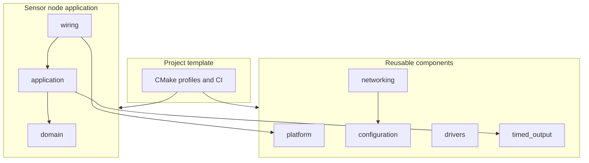

# Architecture

ESPKit separates three things so you can delete what you do not need.

- **Project template.** Root `CMakeLists.txt`, `.github/workflows/`, host tests, and these docs. Copy them with the GitHub template.
- **Reusable components.** `platform`, `configuration`, `networking`, `drivers`, and `timed_output`. Each one builds without the sensor-node workers.
- **Examples.** `minimal`, `networking`, `sensor-node`, `actuator-node`, and `simulation`. They show different programs on the same CI.

There is no shared event bus and no board HAL. A sensor-node worker receives the objects it needs in its constructor. `wiring` adapts ESP-IDF clocks, queues, and tasks to those workers. Networking publishes opaque bytes. The node encodes telemetry and, if you add a subscription later, decodes command payloads itself.

Read the [boundary table](boundaries.md) before you add an include. The [code walkthrough](../code-walkthrough.md) follows one boot of the default sensor firmware. [Safety](../safety.md) explains what the timed-output policy does and does not guarantee.
