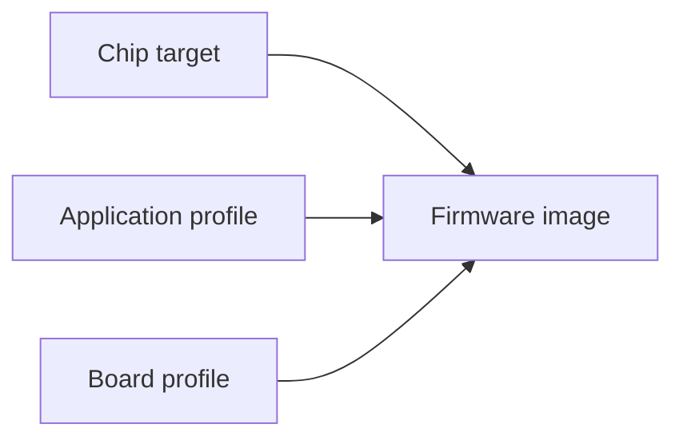

# Profiles, chips, and boards

Three choices are independent. Setting one does not set the others.

| Axis | What you set | Example |
| --- | --- | --- |
| Chip target | `idf.py set-target esp32s3` | ESP32-S3, not a PCB |
| Application profile | `idf.py -DESPKIT_PROFILE=minimal` | Which `app_main` and components are compiled |
| Board profile | An extra `sdkconfig` defaults file you pass yourself | Pins, flash size, console. None is selected yet |



## Application profiles

| Profile | Root firmware |
| --- | --- |
| `minimal` | Logs one line. Does not compile the sensor node or networking |
| `sensor` | Default. Synthetic sample, local timed output, status log |
| `actuator` | Requests ON until the run-time limit latches a fault |

```sh
idf.py -DESPKIT_PROFILE=minimal set-target esp32s3
idf.py -DESPKIT_PROFILE=minimal build
```

Omit `-DESPKIT_PROFILE` to build `sensor`. Delete `sdkconfig` and the build directory before you switch profiles. A saved sdkconfig keeps the previous choice, and the build stops if it disagrees with `-DESPKIT_PROFILE`.

`SDKCONFIG_DEFAULTS` alone does not switch source files. The CMake variable does. Kconfig only records the choice. Details are in [Build profiles](../guides/profiles.md).

## Chip target

`idf.py set-target` selects the ESP-IDF chip. ESP32 family members do not all have the same radios or peripherals. This repository's CI target is `esp32s3`. Do not promise that every chip builds the same features.

## Board profile

No board pin map is selected. Chip defaults such as `sdkconfig.defaults.esp32s3` are not a custom PCB. When you add a board, keep its defaults in a separate file and pass that file explicitly. See [Board porting](../board-porting.md).
