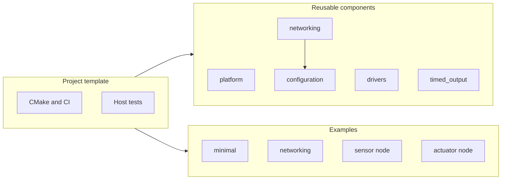

# ESPKit

ESPKit is a small ESP-IDF 5.4.2 starting point for ESP32-S3 firmware. Use the whole repository as a project template, or depend on only the components you need.

ESPKit has three roles. They share one build, test, and documentation setup. They are not three copies of the same application.

-   :material-source-repository: **Project template**

    Copy the repository when you want CMake, CI, formatting, and docs in a new project.

    [:octicons-arrow-right-24: Start from the template](getting-started/index.md)

-   :material-puzzle: **Reusable components**

    Pin `platform`, `configuration`, `networking`, `drivers`, or `timed_output` from an existing ESP-IDF project.

    [:octicons-arrow-right-24: Use a component](guides/components.md)

-   :material-flask: **Examples**

    Build a hello-world app, a networking-only app, or the sensor and actuator demos.

    [:octicons-arrow-right-24: Open the examples](examples.md)

## What you can build today

The default root firmware is a **sensor** profile. It samples a synthetic reading, runs a local timed-output policy, and logs status. It does not drive a GPIO output and it does not need Wi-Fi credentials.

!!! warning "Do not connect a live pump"
    The examples keep outputs in memory. A successful compile is not a hardware test and not permission to drive an actuator. Read [Safety](safety.md) before you add a real output.

| If you want to… | Start here |
| --- | --- |
| Create a new private repository from this template | [Getting started](getting-started/index.md) |
| Compile the smallest application for ESP32-S3 | [Minimal example](examples/minimal.md) |
| See how profiles differ from the chip and the board | [Three axes](concepts/axes.md) |
| Depend on networking without the sensor workers | [Networking example](examples/networking.md) |

Status is **pre-alpha**. Host tests and ESP32-S3 builds run in CI. Live Wi-Fi, broker, and board acceptance tests are still pending. OTA download, MQTT command subscription, and physical actuator drivers are not implemented.
